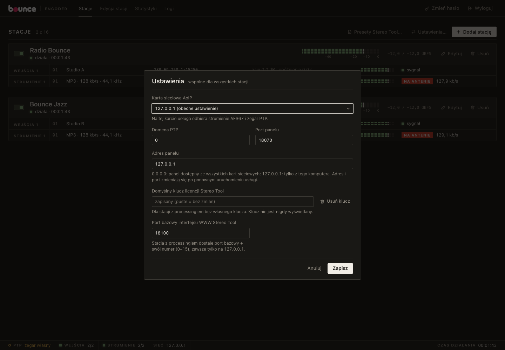
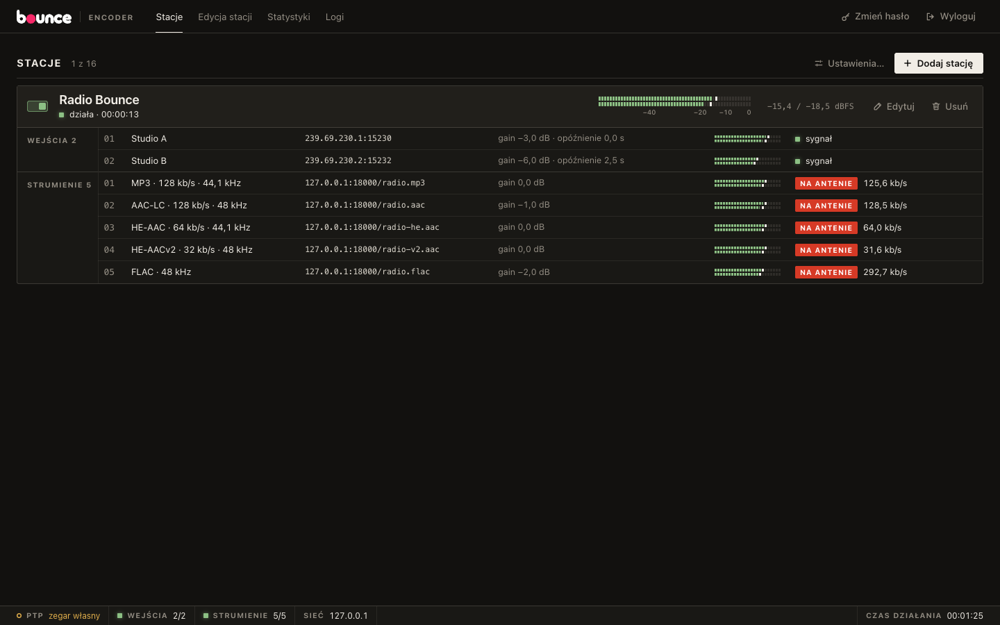
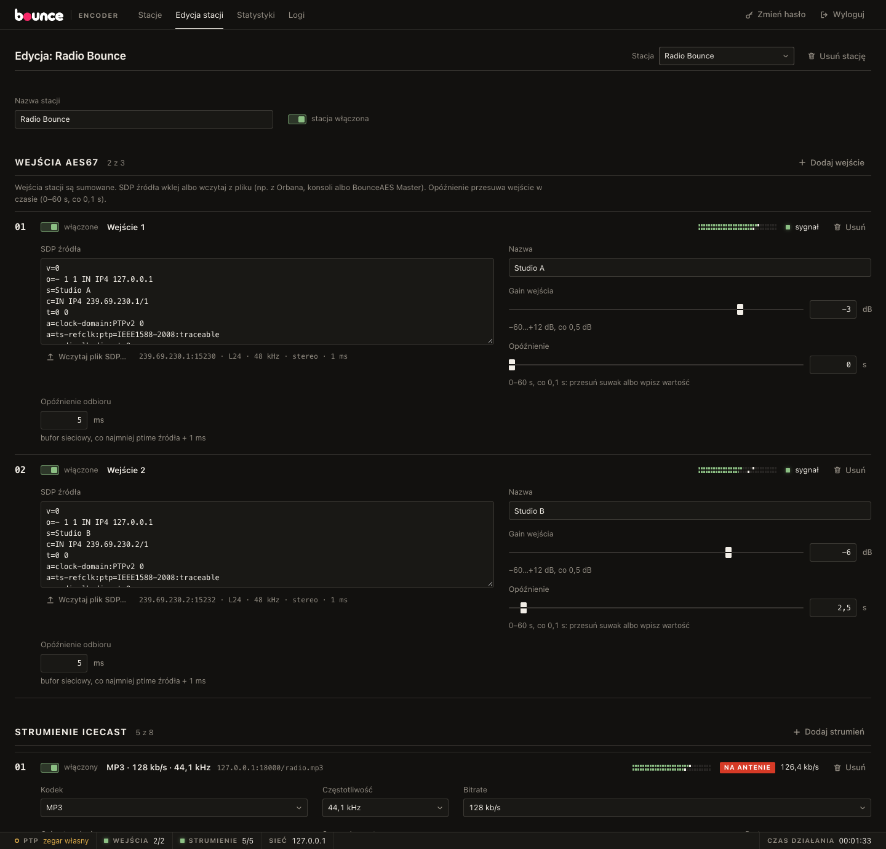
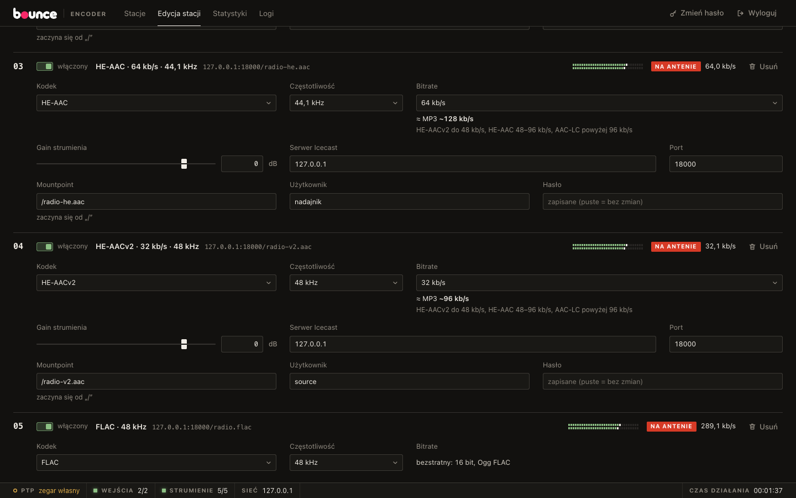
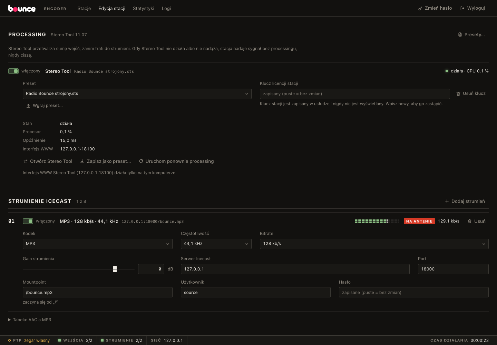

# Bounce Encoder: instalacja i konfiguracja

Bounce Encoder to osobny program Windows, który odbiera strumienie **AES67**, sumuje je w sygnał stacji i wysyła do serwerów **Icecast** w wybranych kodekach (MP3, AAC-LC, HE-AAC, HE-AACv2, FLAC). Obsługuje do 16 stacji naraz. Od wersji 1.1 każda stacja może mieć własny **processing Stereo Tool** (Thimeo): kompresję, limiter, AGC i resztę toru z presetu Stereo Tool (rozdział 10). Bez processingu stacja wysyła swój miks bez zmian. Bounce Encoder nie wysyła metadanych ani RDS.

```
AES67 ─► wejście 1 (gain, opóźnienie) ─┐
AES67 ─► wejście 2 (gain, opóźnienie) ─┼─► miks stacji 48 kHz ─► [Stereo Tool] ─┬─► strumień 1: gain → resampler → kodek → Icecast
AES67 ─► wejście 3 (gain, opóźnienie) ─┘     (processing, opcjonalnie)          ├─► strumień 2: …
                                                                                └─► … (do 8 strumieni)
```

BounceAES Master (sterownik ASIO) i Bounce Encoder to dwa niezależne programy. Mogą działać na jednym komputerze: panel BounceAES Master ma port 8067, panel Bounce Encoder port 8070.

## 1. Wymagania

- Windows 10 lub 11, **64-bit**.
- Karta sieciowa podłączona do sieci AoIP (najlepiej osobna, w VLAN-ie AoIP), a na przełączniku IGMP snooping z querierem.
- Zegar PTPv2 w sieci (Orban, Omnia, konsola albo BounceAES Master w roli mastera), w tej samej domenie co źródła. Bez zsynchronizowanego PTP Bounce Encoder odbiera tylko źródła, które liczą czas tym samym zegarem co on, w praktyce prawie żadne (rozdział 12).
- Dostęp do serwera Icecast 2.4 (albo nowszego) z hasłem źródła.
- Dla stacji z processingiem Stereo Tool: klucz licencji Stereo Tool na każdą taką stację, około jednego rdzenia procesora i 600 MB pamięci na stację (rozdział 10).

## 2. Instalacja

1. Uruchom `BounceEncoder-setup.exe` i potwierdź uprawnienia administratora.
2. Instalator:
   - kopiuje pliki do `C:\Program Files\Bounce Encoder`, razem z bibliotekami kodeków `libmp3lame.dll` (MP3) i `libfdk-aac-2.dll` (AAC) oraz (pełny instalator) biblioteką Stereo Tool `libStereoTool_64.dll` (processing, około 117 MB). Instalator zbudowany automatycznie na GitHubie nie zawiera biblioteki Stereo Tool (rozdział 10, „Instalator bez Stereo Tool”). Program ładuje te biblioteki **tylko ze swojego folderu**. Folder spoza `Program Files` (nowy, pusty albo z poprzednią instalacją) dostaje takie same uprawnienia jak `Program Files`: administratorzy i SYSTEM pełna kontrola, Użytkownicy tylko odczyt i uruchamianie, bez dziedziczenia, bo usługa działa jako SYSTEM i nikt inny nie może podmienić jej plików. Uprawnień istniejącego folderu, w którym są już inne pliki (a nie ma Bounce Encodera), instalator nie zmienia (ostrzega). Jeśli ustawienie uprawnień się nie uda, instalator też ostrzega. Katalog główny dysku nie może być folderem programu;
   - instaluje usługę **Bounce Encoder** (`BounceEncoder`): start automatyczny razem z Windows, restart po awarii po 5 s;
   - rejestruje źródło **Bounce Encoder** w Dzienniku zdarzeń Windows;
   - dodaje regułę zapory dla programu `BounceEncoder.exe`: odbiór AES67 (RTP), PTP 319/320 i panel 8070. Reguła dotyczy tylko tego programu, nie otwiera portów dla innych, ale obowiązuje we **wszystkich profilach sieci** (także „Publiczna”: sieci AoIP Windows zwykle tak klasyfikuje, a bez tego odbiór AES67 by nie działał). Panel jest więc osiągalny z każdej sieci, w której nasłuchuje: ustaw jego adres na kartę sieci administracyjnej (rozdział 4);
   - zakłada folder `C:\ProgramData\Bounce Encoder` z uprawnieniami **tylko dla administratorów i usługi** (SYSTEM), bo `config.json` zawiera hasła strumieni i skrót hasła panelu. Podfolder `public` mogą czytać wszyscy użytkownicy: jest w nim tylko `panel.json` (adres i port panelu dla ikony w zasobniku);
   - dodaje ikonę w zasobniku do autostartu (przy każdym logowaniu);
   - tworzy skrót **Bounce Encoder** na pulpicie i w menu Start (uruchamia ikonę w zasobniku i otwiera panel) oraz w menu Start *Panel Bounce Encoder* (otwiera tylko panel), *Instrukcja* i *Odinstaluj Bounce Encoder*.
3. Pasek zadań: Windows nie pozwala instalatorom przypinać programów. Kliknij prawym przyciskiem skrót na pulpicie → *Pokaż więcej opcji* → *Przypnij do paska zadań*.

Pliki w `C:\ProgramData\Bounce Encoder\`:

| Plik | Zawartość |
|---|---|
| `config.json` | stacje, wejścia, strumienie z hasłami Icecast, ustawienia wspólne, skrót hasła panelu |
| `logs\bounce-encoder.log` | log usługi (5 plików po 10 MB, najstarszy jest usuwany) |
| `public\panel.json` | adres i port panelu dla ikony w zasobniku (bez danych poufnych), zapisywany przy każdym starcie usługi |
| `stereotool\presets\*.sts` | presety Stereo Tool wgrane w panelu albo zapisane przyciskiem „Zapisz jako preset…” (rozdział 10) |
| `stereotool\station-<id>\` | pliki Stereo Tool jednej stacji z processingiem (`<id>` to identyfikator stacji, np. `s3`); usuwane razem ze stacją |
| `config.json.bad` | kopia pliku, którego nie dało się w całości wczytać (rozdział 13) |
| `running.marker` | znacznik pracy usługi: jest, dopóki usługa działa, a poprawne zatrzymanie go usuwa. Zostaje po awarii albo zabiciu procesu; wtedy następny start uruchamia stacje bez processingu (rozdział 10, „Po awarii usługi”) |

Ostrzeżenia i błędy trafiają też do Dziennika zdarzeń Windows (Aplikacja, źródło „Bounce Encoder”).

**Uprawnienia folderu ustawione ręcznie.** Jeśli instalator zgłosił, że nie mógł ustawić uprawnień, albo folder powstał bez instalatora (np. założył go inny użytkownik), zatrzymaj usługę i uruchom w PowerShellu jako administrator:

```powershell
$d = 'C:\ProgramData\Bounce Encoder'
takeown /F $d /A
icacls $d /setowner '*S-1-5-32-544' /T /C /Q
$a = New-Object System.Security.AccessControl.DirectorySecurity
$a.SetSecurityDescriptorSddlForm('D:PAI(A;OICI;FA;;;BA)(A;OICI;FA;;;SY)', 'Access')
(Get-Item -LiteralPath $d).SetAccessControl($a)
icacls "$d\*" /reset /T /C /Q
New-Item -ItemType Directory -Force "$d\public" | Out-Null
icacls "$d\public" /grant:r '*S-1-5-32-545:(OI)(CI)RX'
```

Kolejno:
1. Administratorzy przejmują folder i wszystko w nim (właściciel folderu może zawsze zmienić jego uprawnienia).
2. Folder dostaje jednym poleceniem docelowe uprawnienia (zapisywana jest tylko lista uprawnień, bez właściciela): tylko Administratorzy (`BA`) i SYSTEM (`SY`), pełna kontrola dziedziczona przez wszystko w środku, bez dziedziczenia z `C:\ProgramData`. Folder ani na chwilę nie dziedziczy dostępu Użytkowników z `C:\ProgramData`.
3. Wszystko w folderze traci uprawnienia dodane ręcznie i dziedziczy tylko te z punktu 2.
4. Podfolder `public` dostaje odczyt dla Użytkowników.

`*S-1-5-32-544` to Administratorzy, `*S-1-5-32-545` to Użytkownicy (identyfikatory działają w każdej wersji językowej Windows). Instalator robi to samo przy każdej instalacji i aktualizacji. Folder `stereotool` i wszystko w nim dziedziczy te same uprawnienia (tylko administratorzy i SYSTEM). Jeśli folder zniknie (np. ktoś go usunął), usługa przy starcie zakłada go od razu z tymi samymi uprawnieniami (i `public` z odczytem dla Użytkowników), nigdy z uprawnieniami odziedziczonymi z `C:\ProgramData`.

## 3. Pierwsze uruchomienie panelu

1. Kliknij dwukrotnie ikonę Bounce Encoder w zasobniku albo skrót na pulpicie. Możesz też otworzyć `http://127.0.0.1:8070` w przeglądarce na tym komputerze.
2. Ustaw hasło panelu (co najmniej 8 znaków). Pierwsze hasło można ustawić **tylko z tego komputera**, w panelu otwartym pod adresem `http://127.0.0.1:8070` albo `http://localhost:8070` (nie przez nazwę komputera ani jego adres w sieci: to chroni przed stronami WWW, które podszywają się pod adres tego komputera). W innym przypadku panel pokaże tylko tę informację.
3. Potem panel jest dostępny również z innych komputerów pod `http://<adres-komputera>:8070`, po zalogowaniu. Jeśli panel ma być dostępny spoza sieci firmowej, wystaw go przez odwrotne proxy z HTTPS. Proxy na tym samym komputerze sprawia, że dla usługi każde żądanie przychodzi z tego komputera: pierwsze hasło dałoby się wtedy ustawić z zewnątrz (ustaw je przed uruchomieniem proxy), a nieudane logowania wszystkich klientów liczą się razem, więc blokada po błędnych hasłach dotyczy wszystkich naraz.
4. Otwórz **Ustawienia…** (rozdział 4) i wybierz kartę sieciową AoIP.

**Zmień hasło** (u góry panelu) zmienia hasło. Inne otwarte panele, także na innych komputerach, trzeba wtedy zalogować ponownie.

**Zapomniane hasło.**
1. Zatrzymaj usługę (`services.msc` → Bounce Encoder → Zatrzymaj).
2. Jako administrator otwórz `C:\ProgramData\Bounce Encoder\config.json` w Notatniku. Zmień wartość `"password_hash"` na `""`, a `"http_bind"` na `"127.0.0.1"` (zapamiętaj poprzednią wartość) i zapisz. Pierwsze hasło przyjmuje tylko połączenie z adresu `127.0.0.1`: gdy panel nasłuchuje na adresie karty, przeglądarka na tym komputerze łączy się z adresu tej karty i usługa uzna ją za komputer zdalny.
3. Uruchom usługę, otwórz `http://127.0.0.1:8070` na tym komputerze i ustaw nowe hasło.
4. W **Ustawienia…** wpisz z powrotem poprzedni adres panelu, zapisz i uruchom usługę ponownie.

Stacje i strumienie zostają bez zmian.

Ikona w zasobniku ma litery **BE** (BounceAES Master: **BA**) i kolorową kropkę w prawym dolnym rogu:

| Kolor | Znaczenie |
|---|---|
| zielony | usługa działa, każdy włączony strumień nadaje i każde włączone wejście ma sygnał |
| żółty | usługa działa, ale któryś strumień nie nadaje albo któreś wejście nie ma sygnału |
| czerwony | usługa nie odpowiada |

Podpowiedź ikony pokazuje liczbę nadających strumieni, wejść z sygnałem i stan PTP. Menu ikony ma pozycje *Otwórz panel*, *Statystyki* i *Zakończ*. *Zakończ* zamyka tylko ikonę: usługa i strumienie działają dalej.

## 4. Ustawienia wspólne (przycisk „Ustawienia…”)



| Pole | Opis |
|---|---|
| Karta sieciowa AoIP | karta, na której usługa odbiera strumienie AES67 i zegar PTP. „Automatycznie” wybiera pierwszą aktywną kartę i sprawdza ją co około 2 s: jeśli karta dostanie adres dopiero po starcie usługi albo go zmieni, wejścia i PTP same przechodzą na nowy adres (strumienie nadają dalej). Przy kilku kartach wybierz właściwą ręcznie. Zmiana działa od razu |
| Domena PTP | taka jak w grandmasterze (w SDP z Orbana: `a=clock-domain:PTPv2 0`). Zmiana działa od razu |
| Adres panelu | `0.0.0.0`: panel dostępny ze wszystkich kart sieciowych; `127.0.0.1`: tylko z tego komputera; adres jednej karty: tylko z tej sieci |
| Port panelu | domyślnie 8070 |
| Domyślny klucz licencji Stereo Tool | klucz używany przez stacje z processingiem, które nie mają własnego klucza (rozdział 10). Pole jak hasło: zapisany klucz nigdy nie jest wyświetlany, puste pole oznacza „bez zmian”, **Usuń klucz** go kasuje |
| Port bazowy interfejsu WWW Stereo Tool | domyślnie 8100. Stacja z processingiem dostaje port bazowy + swój numer (0–15), więc porty 8100–8115. Interfejs nasłuchuje zawsze tylko na `127.0.0.1`. Zmiana uruchamia od nowa Stereo Tool stacji, których port się zmienia (kilka sekund bez processingu) |

Adres i port panelu zmieniają się po ponownym uruchomieniu usługi (`services.msc` → Bounce Encoder → Uruchom ponownie). Ikona w zasobniku i skrót *Panel Bounce Encoder* w menu Start same odczytają nowy adres (z `public\panel.json`). Link na ostatniej stronie instalatora prowadzi zawsze do `http://127.0.0.1:8070`.

**Zalecenie:** ustaw adres panelu na kartę sieci administracyjnej (biurowej), a nie na kartę AoIP ani `0.0.0.0`. Panel ma logowanie, ale powinien być dostępny tylko z zaufanej sieci (rozdział 14).

## 5. Stacje (zakładka Stacje)



Stacja to jeden sygnał (np. jeden program radiowy): do 3 wejść AES67, które są sumowane, i do 8 strumieni Icecast z tym samym dźwiękiem w różnych kodekach albo na różnych serwerach. Bounce Encoder obsługuje do **16 stacji**.

Lista pokazuje dla każdej stacji:
- przełącznik włączenia: działa od razu, bez zapisywania. Wyłączona stacja rozłącza wszystkie swoje strumienie;
- stan („działa” i czas działania), miernik sygnału stacji i szczyt w dBFS;
- wejścia: nazwa, adres strumienia AES67, gain i opóźnienie, miernik, stan („sygnał”, „brak sygnału” albo błąd);
- strumienie: kodek, bitrate i częstotliwość, serwer i mountpoint, gain, miernik, stan (lampka **NA ANTENIE** z bitrate'em, „łączenie…”, komunikat błędu z rozdziału 9);
- processing (stacja z processingiem): stan Stereo Tool i zużycie procesora, np. „działa · CPU 12,3 %”, albo przyczyna, dla której stacja nadaje bez processingu (rozdział 10).

Przycisk **Presety Stereo Tool…** nad listą otwiera okno presetów (rozdział 10). **Dodaj stację** otwiera edytor nowej stacji. **Edytuj** otwiera edytor istniejącej, **Usuń** usuwa stację od razu (po potwierdzeniu) i rozłącza jej strumienie.

### Edycja stacji
Zakładka **Edycja stacji** ma pole wyboru stacji, nazwę, przełącznik „stacja włączona”, wejścia, processing (rozdział 10) i strumienie. Zmiany wysyła przycisk **Zapisz stację** na dole ekranu (**Odrzuć** je cofa). Zapis dotyczy tylko edytowanej stacji, inne stacje grają dalej bez przerwy. W edytowanej stacji od nowa łączą się tylko strumienie, które się zmieniły. Wyjątek: **zmiana nazwy stacji** łączy od nowa wszystkie jej włączone strumienie (nazwa stacji jest nazwą strumienia `Ice-Name` na serwerze), więc słuchacze usłyszą krótką przerwę; panel ostrzega o tym na pasku zapisu. Błędy (np. mountpoint bez „/”) panel pokazuje czerwonym kolorem przy polu i nic nie zapisuje, dopóki ich nie poprawisz.

Jeśli ktoś w tym czasie zmieni tę samą stację w innym panelu, panel zapyta przed zapisem, czy zastąpić tamte zmiany.

## 6. Wejścia AES67



Każde wejście to jeden odbierany strumień AES67: L16 albo L24, 48 kHz, mono lub stereo, multicast. Wejścia stacji są sumowane, każde z własnym gainem.

| Pole | Opis |
|---|---|
| włączone | wyłączone wejście nie trafia do miksu (płynnie, rampa 5 ms) |
| SDP źródła | opis strumienia: wklej tekst SDP albo kliknij **Wczytaj plik SDP…** (plik `.sdp`, do 64 KB). Pod polem panel pokazuje odczytany adres, format, częstotliwość, kanały i ptime |
| Nazwa | nazwa wejścia w panelu; puste pole oznacza nazwę sesji z SDP |
| Gain wejścia | −60…+12 dB, co 0,5 dB. Zmiana jest płynna (rampa 5 ms) |
| Opóźnienie | 0–60 s, co 0,1 s: przesuń suwak albo wpisz wartość w pole obok |
| Opóźnienie odbioru | bufor na jitter sieci, w ms. Co najmniej ptime źródła + 1 ms (dla Orbana z ptime 1,333 ms: 2,334 ms), najwyżej 1000 ms. Domyślnie 5 ms |

Skąd wziąć SDP:
- **Orban Optimod**: w ustawieniach wyjścia AES67 (przycisk pobrania SDP). Przykład jest w folderze programu: `przyklad-orban.sdp`.
- **Konsola** albo inne urządzenie AES67: plik SDP strumienia z jego panelu.
- **BounceAES Master**: przycisk **SDP** przy wyjściu AoIP (*Kopiuj* albo *Pobierz plik .sdp*).

**Opóźnienie** przesuwa wejście w czasie, np. żeby zgrać studio z nadajnikiem albo dać czas na reakcję. Zmiana w trakcie pracy przechodzi płynnie (wyciszenie i podgłośnienie 5 ms, bez trzasku): zwiększenie opóźnienia wstawia ciszę o długości różnicy, zmniejszenie przeskakuje do przodu. Każde włączone wejście ma bufor na pełne 60 s (około 23 MB pamięci).

Jedno źródło (ten sam adres multicast, port i nadawca) może być tylko w jednym włączonym wejściu stacji: dwa takie wejścia zsumowałyby ten sam dźwięk dwa razy (+6 dB), więc panel nie zapisze takiej stacji.

Zmiana samego opóźnienia odbioru nie kasuje opóźnienia wejścia. Zmiana SDP to nowe źródło: bufor opóźnienia zaczyna się od ciszy.

Brak pakietów na wejściu oznacza ciszę, a nie przerwę w strumieniach: słuchacze słyszą ciszę, połączenia z Icecastem trwają. Stacja bez wejść też nadaje ciszę.

## 7. Strumienie Icecast



Każdy strumień wysyła sygnał stacji do jednego mountpointu na serwerze Icecast.

| Pole | Opis |
|---|---|
| włączony | wyłączony strumień rozłącza się z serwerem |
| Kodek | MP3, AAC-LC, HE-AAC, HE-AACv2 albo FLAC (rozdział 8). Niedostępny kodek jest wyszarzony z opisem przyczyny |
| Częstotliwość | 48 / 44,1 / 32 / 24 / 22,05 kHz, zależnie od kodeka |
| Bitrate | lista zawiera tylko wartości dozwolone dla kodeka i częstotliwości. Przy AAC pod polem jest odpowiednik MP3 i podpowiedź profilu. FLAC nie ma bitrate'u |
| Gain strumienia | −60…+12 dB, co 0,5 dB, tylko dla tego strumienia. Sygnał powyżej 0 dBFS jest przycinany, nie zawija się |
| Serwer Icecast | nazwa serwera albo adres IPv4, bez `http://` i bez portu |
| Port | port serwera Icecast, zwykle 8000 |
| Mountpoint | zaczyna się od „/”, bez spacji, „?” i „#”, np. `/radio.mp3`. Ten sam serwer i mountpoint może mieć tylko jeden strumień, który nadaje: porównywane są tylko włączone strumienie włączonych stacji. Wyłączony strumień i wyłączona stacja (np. zapasowa) mogą mieć te same mountpointy |
| Użytkownik | zwykle `source` (puste pole oznacza `source`) |
| Hasło | hasło źródła Icecast. Wymagane dla włączonego strumienia |

**Hasła.** Panel nigdy nie pokazuje zapisanych haseł. Puste pole oznacza „bez zmian” (podpowiedź „zapisane (puste = bez zmian)”). Po zmianie serwera albo portu panel prosi: **„po zmianie serwera wpisz hasło ponownie”**. Bounce Encoder nie wyśle zapisanego hasła do innego serwera, więc bez nowego hasła strumienia nie da się zapisać.

**Zmiana strumienia w trakcie pracy** (np. bitrate'u): po zapisaniu ten strumień zamyka połączenie i łączy się od nowa, z nowymi ustawieniami. Inne strumienie i stacje nadają bez przerwy.

Każdy strumień ma własny wątek i dwie kolejki, więc wolny serwer albo sieć nie wstrzymuje innych strumieni ani stacji:
- **dźwięk przed kodekiem** (5 s): gdy kodek nie nadąża (przeciążony procesor), najstarsze ramki są odrzucane i liczone w Statystykach („Ramki: kolejka”);
- **dane do serwera** (5 s przy ustawionym bitrate, ale co najmniej 64 KB, więc przy niskich bitrate'ach dłużej: np. 64 KB to około 16 s przy 32 kb/s; FLAC: 5 s dźwięku przed kompresją): gdy serwer albo łącze nie nadąża, cała zaległa kolejka jest odrzucana (liczona w „Odrzucone”), a kodek zaczyna strumień od nowa od nowej ramki (FLAC: od nowego nagłówka). Słuchacze słyszą krótką przerwę, ale strumień zostaje poprawny i połączenie trwa.

## 8. Kodeki i bitrate

| Kodek | Biblioteka | Bitrate (kb/s) | Częstotliwości | Content-Type |
|---|---|---|---|---|
| MP3 | LAME, CBR, joint stereo | 32–320 przy 48 / 44,1 / 32 kHz (32, 40, 48, 56, 64, 80, 96, 112, 128, 160, 192, 224, 256, 320); 32–160 przy 24 / 22,05 kHz (32 … 128, 144, 160) | 48 000, 44 100, 32 000, 24 000, 22 050 | `audio/mpeg` |
| AAC-LC | Fraunhofer FDK AAC, ADTS | 32–320 (przy 24 kHz najwyżej 288, przy 22,05 kHz najwyżej 264) | 48 000, 44 100, 32 000, 24 000, 22 050 | `audio/aac` |
| HE-AAC (v1) | FDK AAC, ADTS | 24–128 | 48 000, 44 100, 32 000 | `audio/aacp` |
| HE-AACv2 | FDK AAC, ADTS | 16–64 | 48 000, 44 100, 32 000 | `audio/aacp` |
| FLAC | libFLAC w kontenerze Ogg, poziom 5, 16 bit | bezstratny (zwykle 700–1000 kb/s przy 48 kHz, zależnie od materiału) | 48 000, 44 100, 32 000, 24 000, 22 050 | `audio/ogg` |

Wszystkie strumienie są stereo. Sygnał stacji ma 48 kHz; inne częstotliwości powstają przez resampling (libsamplerate). Panel odrzuca kombinacje, przy których kodek po cichu nadawałby z niższym bitrate'em niż ustawiony (np. MP3 192 kb/s przy 22,05 kHz).

### AAC a MP3
Przy tym samym brzmieniu AAC potrzebuje mniejszego bitrate'u niż MP3. Panel pokazuje odpowiednik pod polem Bitrate, a pełną tabelę pod przyciskiem *Tabela: AAC a MP3*:

| AAC | ≈ MP3 |
|---|---|
| HE-AACv2 32 kb/s | ~96 kb/s |
| HE-AAC 48–64 kb/s | ~128 kb/s |
| AAC-LC 96 kb/s | ~128–160 kb/s |
| AAC-LC 128 kb/s | ~192 kb/s |
| AAC-LC 192+ kb/s | ~256–320 kb/s |

**Który profil AAC:** HE-AACv2 do 48 kb/s, HE-AAC 48–96 kb/s, AAC-LC powyżej 96 kb/s. Gdy wybrany profil nie pasuje do bitrate'u, panel podpowiada lepszy (np. „przy 128 kb/s lepiej: AAC-LC”).

Wskazówki:
- Słuchacze w przeglądarkach i aplikacjach mobilnych: AAC-LC 128 kb/s albo HE-AAC 64 kb/s. Starsze odtwarzacze i urządzenia: MP3 128 kb/s.
- Słaby zasięg mobilny: HE-AACv2 32–48 kb/s.
- Przekaz do innego studia albo nadajnika, archiwum: FLAC. Ogg FLAC odtwarzają m.in. VLC i foobar2000; przeglądarki różnie, więc dla słuchaczy wybierz MP3 albo AAC. Bounce Encoder wysyła stronę Ogg co najmniej co ~250 ms dźwięku, więc Icecast nie rozłącza źródła nawet przy ciszy.
- Obciążenie procesora: HE-AAC to około 2–4% jednego rdzenia na strumień. 16 stacji × 8 strumieni to limit konfiguracji, a nie zalecenie: przy wielu strumieniach sprawdź obciążenie w Menedżerze zadań.

**Kodek niedostępny.** Bez pliku `libfdk-aac-2.dll` obok programu AAC, HE-AAC i HE-AACv2 są w panelu wyszarzone („kodek … niedostępny: brak biblioteki libfdk-aac obok programu”), a takie strumienie mają stan „kodek niedostępny”. MP3 (`libmp3lame.dll`) i FLAC działają dalej. Zainstaluj program ponownie, żeby przywrócić pliki.

## 9. Serwer Icecast i komunikaty błędów

### Ustawienia po stronie Icecasta (`icecast.xml`)
- **Hasło źródła**: `<authentication><source-password>` dla wszystkich mountpointów albo `<mount>` z własnym `<username>` i `<password>` dla jednego mountpointu. Te same dane wpisz w polach Użytkownik i Hasło.
- **Limit źródeł**: `<limits><sources>` musi być co najmniej równy liczbie strumieni wysyłanych na ten serwer (ze wszystkich enkoderów).
- **Source timeout**: `<limits><source-timeout>` (domyślnie 10 s) może zostać. Bounce Encoder wysyła dane bez przerwy, także przy ciszy.
- Bounce Encoder łączy się metodą `PUT` (Icecast 2.4 i nowsze), z `Expect: 100-continue`. Starszy serwer, który odrzuci `PUT`, dostaje automatycznie starsze żądanie `SOURCE`.
- Strumienie są wysyłane z `Ice-Public: 0`, więc nie trafiają do publicznych katalogów stacji. Nazwa strumienia (`Ice-Name`) to nazwa stacji.
- Połączenie z Icecastem jest zwykłym TCP (HTTP), bez TLS.

### Ponawianie połączenia
Po błędzie strumień próbuje ponownie po 1, 2, 5 i 10 s, potem co 10 s, bez końca. Stan w panelu to wtedy komunikat błędu, a licznik „Ponowienia” w Statystykach rośnie. Po każdym połączeniu kodek zaczyna od nowej ramki (FLAC: od nowego nagłówka strumienia), więc odtwarzacze dostają poprawny strumień.

### Komunikaty
| Stan strumienia | Znaczenie | Co sprawdzić |
|---|---|---|
| nadaje · N kb/s | strumień działa, N to rzeczywisty bitrate | — |
| łączenie… | trwa łączenie z serwerem | — |
| złe hasło lub użytkownik | Icecast odpowiedział 401 | hasło i użytkownik źródła w `icecast.xml` (także w sekcji `<mount>`), wielkość liter |
| mountpoint zajęty lub zabroniony | Icecast odpowiedział 403 | czy inny enkoder nie nadaje na ten mountpoint; limit `<sources>`; czy mountpoint jest dozwolony w konfiguracji serwera. Po zmianie strumienia Icecast bywa, że zwalnia mountpoint chwilę później: kolejna próba się uda |
| serwer nieosiągalny | brak połączenia TCP w ciągu ~10 s | nazwa i port serwera, zapora (wychodzące połączenia), czy Icecast działa |
| nie można znaleźć serwera … | nazwa serwera nie istnieje w DNS | pisownia nazwy, DNS komputera; można wpisać adres IP |
| serwer nie odpowiada | połączenie jest, ale serwer nie odpowiedział w ciągu 5 s | czy pod tym portem działa Icecast, obciążenie serwera |
| nieprawidłowa odpowiedź serwera | odpowiedź nie wygląda jak Icecast | port (np. port HTTPS albo innej usługi), odwrotne proxy przed Icecastem |
| serwer zamknął połączenie | serwer rozłączył się przed odpowiedzią | logi Icecasta (`error.log`) |
| serwer odrzucił połączenie (HTTP N) | inny kod błędu HTTP | logi Icecasta |
| połączenie przerwane | połączenie zerwane w trakcie nadawania | sieć, restart Icecasta; strumień wraca sam |
| serwer nie odbiera danych | przez 10 s serwer nie przyjął żadnych danych | sieć, przeciążony serwer |
| kodek niedostępny | brak biblioteki kodeka | rozdział 8 |
| błąd kodera: … | kodek nie przyjął ustawień albo danych | logi; zgłoś błąd z treścią komunikatu |

## 10. Processing (Stereo Tool)



Processing to Stereo Tool firmy Thimeo (wersja 11.07) wbudowany w Bounce Encoder: biblioteka `libStereoTool_64.dll` w folderze programu. Każda stacja może mieć własny Stereo Tool z własnym presetem. Stereo Tool przetwarza miks stacji (sumę wejść), zanim trafi on do strumieni, więc wszystkie strumienie stacji dostają ten sam przetworzony dźwięk. Stacje bez processingu działają jak w wersji 1.0.

**Nigdy cisza z powodu processingu.** Gdy Stereo Tool się uruchamia, nie nadąża, zgłosi błąd, ulegnie awarii albo jego licencja nie obejmuje użytych funkcji, stacja płynnie (przenikanie 5 ms, bez trzasku) przechodzi na sygnał bez processingu, a panel pokazuje przyczynę. Strumienie nadają dalej.

### Licencje (klucz na stację)
- **Jedna licencja Stereo Tool = jedna stacja z processingiem.** Klucz wpisz w edycji stacji (pole **Klucz licencji stacji**) albo raz jako **Domyślny klucz licencji Stereo Tool** w oknie Ustawienia… (rozdział 4): stacja bez własnego klucza używa domyślnego. Bez żadnego klucza processingu nie da się włączyć.
- Klucz wklejaj w całości, razem z nawiasami `<` i `>`.
- Klucz jest tajny jak hasła strumieni: panel nigdy go nie pokazuje (podpowiedź „zapisany (puste = bez zmian)”), nie ma go w logach ani w odpowiedziach usługi. Puste pole przy zapisie zostawia zapisany klucz, **Usuń klucz** go kasuje.
- Ten sam klucz na dwóch włączonych stacjach z processingiem (także klucz domyślny użyty przez dwie stacje): panel zapisuje zmiany, ale ostrzega „ten sam klucz licencji Stereo Tool co stacja …: sprawdź, czy licencja obejmuje obie stacje”.
- Licencja jest sprawdzana po pierwszych 0,5 s dźwięku i potem co 250 ms. Stereo Tool bez licencji na funkcję, której używa preset, może słyszalnie oznaczać dźwięk, dlatego taka stacja nadaje sygnał bez processingu, a panel wymienia funkcje bez licencji (stan „licencja: brak …”).

### Presety
Preset to plik `.sts` z ustawieniami Stereo Tool. Presety są wspólne dla wszystkich stacji i leżą w `C:\ProgramData\Bounce Encoder\stereotool\presets` (tylko dla administratorów).

- **Presety Stereo Tool…** (nad listą stacji) pokazuje listę z rozmiarem i stacjami, które używają presetu. **Wgraj preset…** dodaje plik `.sts` z dysku (do 4 MB, najwyżej 64 presety), **Pobierz** zapisuje preset na dysk, **Usuń** usuwa preset, którego nie używa żadna stacja.
- Nazwa presetu: litery, cyfry, spacja, „-”, „_” i „.”, z rozszerzeniem `.sts`, najwyżej 64 znaki. Polskie litery panel zamienia przy wgrywaniu na łacińskie (np. „Jazz łagodny.sts” → „Jazz lagodny.sts”). Wielkość liter nie ma znaczenia: `FM.sts` i `fm.sts` to ten sam preset.
- Preset może pochodzić z innego Stereo Tool (plik `.sts` zapisany w Stereo Tool na innym komputerze) albo z Bounce Encodera: przycisk **Zapisz jako preset…** zapisuje bieżące ustawienia stacji (niżej).

### Włączenie processingu na stacji
1. W **Edycja stacji** → sekcja **Processing** włącz przełącznik, wybierz preset z listy (albo **Wgraj preset…**) i wpisz klucz licencji (albo zostaw puste pole, gdy jest klucz domyślny).
2. **Zapisz stację.** Strumienie stacji nadają dalej bez przerwy: najpierw bez processingu, a po około 1–2 s (uruchomienie Stereo Tool i sprawdzenie licencji) z processingiem, z płynnym przejściem.
3. Uruchomienie Stereo Tool trwa około 1 s na stację, a stacje uruchamiają go jedna po drugiej. Po starcie usługi z wieloma stacjami z processingiem ostatnia dostaje processing po kilkunastu sekundach (np. przy 16 stacjach po około 16 s); do tego czasu każda nadaje bez processingu.
4. Przy starcie processingu wysyłanie do strumieni zatrzymuje się jednorazowo na czas opóźnienia Stereo Tool (około 90 ms): nic nie jest wycinane ani wstawiane, dźwięk dociera do serwera o tyle później. Słuchacze tego nie słyszą (odtwarzacze mają własny bufor). Odtąd cała stacja ma to opóźnienie (pole **Opóźnienie**, zwykle około 90 ms).

Zmiana presetu w działającej stacji: płynne przejście na sygnał bez processingu, wczytanie presetu, sprawdzenie licencji i płynny powrót (około 1 s). Zmiana klucza albo portu interfejsu WWW uruchamia Stereo Tool stacji od nowa (kilka sekund bez processingu). Wyłączenie processingu: płynne przejście na sygnał bez processingu.

Gdy stacja ma preset, którego nie ma w folderze presetów (np. po ręcznej zmianie `config.json`), lista pokazuje go z dopiskiem „nie ma go w folderze presetów”, a stacja nadaje bez processingu. Processing ruszy sam po wgraniu presetu o tej nazwie.

### Strojenie: interfejs WWW Stereo Tool
Każda stacja z processingiem ma interfejs WWW swojego Stereo Tool (pełne ustawienia, mierniki), pod adresem `http://127.0.0.1:<port>/`, gdzie port to port bazowy (domyślnie 8100) + numer stacji (0–15). Numer stacja dostaje przy dodaniu i zachowuje go na stałe, także gdy inne stacje są usuwane albo przestawiane (pole **Interfejs WWW** pokazuje adres, gdy processing działa).

- **Otwórz Stereo Tool** otwiera ten interfejs w nowej karcie, ale **tylko w panelu otwartym na komputerze z Bounce Encoderem** (pod `http://127.0.0.1:8070`). Interfejs nasłuchuje wyłącznie na `127.0.0.1`, więc z innego komputera jest nieosiągalny (celowo). Z innego komputera połącz się z komputerem enkodera przez **pulpit zdalny** i tam otwórz panel. W panelu otwartym zdalnie przycisk jest wyłączony z tym wyjaśnieniem.
- **Hasło interfejsu WWW.** Adres `127.0.0.1` otworzy każdy, kto pracuje na komputerze enkodera (także inny użytkownik albo program na tym komputerze), dlatego interfejs WWW Stereo Tool pyta o własne hasło Stereo Tool (konto Admin). Bounce Encoder ustawia je sam: losowe, osobne dla każdej stacji. Pokazuje je przycisk **Pokaż hasło** obok „Otwórz Stereo Tool”, tylko po zalogowaniu do panelu, z przyciskiem **Kopiuj** (gdy przeglądarka nie pozwala kopiować, hasło jest zaznaczone: Ctrl+C). Hasła nie ma w logach, w stanie usługi ani w zapisanych presetach. Zostaje to samo przy zmianie presetu i przy **Uruchom ponownie processing**; nowe dostaje nowy Stereo Tool stacji (zmiana klucza albo portu, ponowne uruchomienie usługi). Hasło ustawione w interfejsie WWW zostanie nadpisane przy najbliższym wczytaniu presetu.
- Zmiany w interfejsie WWW działają od razu, ale **nie są zapisywane w presecie**. Przepadają przy ponownym uruchomieniu usługi, zmianie presetu albo klucza. Żeby je zachować, kliknij **Zapisz jako preset…**, podaj nową nazwę (np. „Radio X strojony.sts”), a potem wybierz ten preset w stacji i zapisz stację. Zapis trwa zwykle ułamek sekundy (najwyżej 10 s); jeśli trwa dłużej niż 0,2 s, stacja na ten czas nadaje bez processingu.
- **Uruchom ponownie processing** wychodzi z obejścia (np. po poprawieniu ustawień, które nie mieściły się w licencji) i próbuje od nowa. Działający Stereo Tool zostaje z bieżącymi ustawieniami (także z interfejsu WWW); po błędzie powstaje nowy.
- Presety wybieraj **w panelu**, nie w menu presetów interfejsu WWW Stereo Tool: tylko preset wczytany przez Bounce Encoder przechodzi przez wyłączenie funkcji sieciowych (niżej).

### Funkcje sieciowe Stereo Tool
Stereo Tool ma własne funkcje sieciowe: wyjście strumieniowe (Icecast/Shoutcast), serwer UECP (RDS), nadawanie i odbiór MicroMPX, Kantar, przekaźnik RDS, wejście Livewire, wykrywanie Livewire/Dante/Ravenna (AES67), a także dwa sposoby samodzielnego wczytywania ustawień (Poll STS i harmonogram presetów). Preset zapisany w Stereo Tool na innym komputerze może mieć którąś z nich włączoną, np. wysyłać strumień do produkcyjnego Icecasta jako drugie źródło albo nasłuchiwać na porcie UECP. Dlatego Bounce Encoder **wyłącza je wszystkie** zaraz po uruchomieniu Stereo Tool stacji i **po każdym wczytaniu presetu**, i sprawdza, że są wyłączone. Działa tylko interfejs WWW tej stacji (na `127.0.0.1`, z hasłem). Jeśli Stereo Tool którejś nie wyłączy, stacja nadaje bez processingu, a stan mówi „Stereo Tool nie wyłączył funkcji sieciowej: …”. Nie włączaj tych funkcji w interfejsie WWW: działałyby do najbliższego wczytania presetu.

### Po awarii usługi
Żeby awaria wewnątrz Stereo Tool nie powtarzała się w kółko (usługa po awarii uruchamia się ponownie po 5 s), Bounce Encoder zapisuje przy starcie znacznik `C:\ProgramData\Bounce Encoder\running.marker`, który poprawne zatrzymanie usługi usuwa. Jeśli usługa przy starcie znajdzie znacznik z poprzedniego uruchomienia (awaria, zabicie procesu, wyłączenie zasilania), a wtedy działał processing, **każda stacja z processingiem startuje bez niego**: nadaje sygnał bez processingu, stan „wyłączony po awarii usługi · uruchom ponownie processing” (pełna przyczyna: „awaria przy poprzednim uruchomieniu — processing wyłączony, uruchom ponownie ręcznie”), a log ma ostrzeżenie z nazwami stacji. Processing stacji wraca po **Uruchom ponownie processing**, po zapisaniu tej stacji w panelu albo po zmianie jej ustawień processingu (preset, klucz). Przed ponownym włączeniem sprawdź log z poprzedniego uruchomienia; jeśli awaria wraca przy tym samym presecie, zgłoś go z logiem.

### Instalator bez Stereo Tool
Repozytorium Bounce Encodera i pliki budowane na GitHubie (artefakty `BounceEncoder-setup` i `BounceEncoder-binaries`) są publiczne, więc nie zawierają niczego od Thimeo: ani `libStereoTool_64.dll`, ani noty `StereoTool-NOTICE.txt`. Z takim instalatorem processing pokazuje „brak biblioteki Stereo Tool …”, a reszta programu działa normalnie (stacje bez processingu). Instalacja takiego instalatora na miejscu wcześniejszej pełnej zostawia bibliotekę i notę na miejscu. Pełny instalator buduje się lokalnie z tych samych plików i biblioteki z SDK Thimeo (rozdział 16, „Budowanie ze źródeł”); tylko ten trafia do stacji.

### Stan processingu
Stan widać w edycji stacji (pola **Stan**, **Procesor**, **Opóźnienie**, **Interfejs WWW**) i w skrócie na liście stacji. Pełna przyczyna jest w podpowiedzi i w logu.

| Stan | Znaczenie | Co zrobić |
|---|---|---|
| działa · CPU N % | Stereo Tool przetwarza sygnał stacji. CPU to czas pracy Stereo Tool w stosunku do czasu dźwięku (100 % = jeden rdzeń) | — |
| działa · CPU N % (ponad 80 %) | Stereo Tool zajmuje ponad 80 % czasu jednego rdzenia (kolor ostrzeżenia na liście i w edycji stacji): przy chwilowym obciążeniu komputera może zacząć nie nadążać | lżejszy preset, mniej stacji z processingiem na tym komputerze albo szybszy procesor (niżej) |
| uruchamianie… | Stereo Tool się uruchamia (około 1 s; po starcie usługi stacje po kolei, więc ostatnia może czekać kilkanaście sekund), stacja nadaje bez processingu | — |
| sprawdzanie licencji… | pierwsze 0,5 s dźwięku przez Stereo Tool, na antenie jeszcze bez processingu | — |
| zapis presetu… | trwa **Zapisz jako preset…** | — |
| nie nadąża · ponowna próba za … | Stereo Tool zalega ponad 200 ms (przeciążony procesor albo zbyt ciężki preset); stacja nadaje bez processingu | Bounce Encoder sam próbuje ponownie po 30 s, potem po 2, 5 i dalej co 10 min; po 10 min pracy bez problemu licznik prób zaczyna się od nowa. Sprawdź obciążenie procesora (niżej) |
| licencja: brak … | licencja nie obejmuje wymienionych funkcji presetu; stacja nadaje bez processingu (bez automatycznych prób) | wyłącz te funkcje w interfejsie WWW, zapisz preset i **Uruchom ponownie processing**, albo użyj klucza z odpowiednią licencją |
| błąd Stereo Tool | Stereo Tool zgłosił błąd przy przetwarzaniu | **Uruchom ponownie processing**; gdy wraca, inny preset; log |
| czeka na Stereo Tool… | Stereo Tool nie wrócił z wywołania; ponowne uruchomienie czeka na niego | poczekaj; jeśli trwa, uruchom ponownie usługę |
| wyłączony po awarii usługi · uruchom ponownie processing | poprzednie uruchomienie usługi skończyło się awarią (albo zabiciem procesu), gdy działał processing; stacja nadaje bez processingu (niżej, „Po awarii usługi”) | sprawdź log z poprzedniego uruchomienia; **Uruchom ponownie processing** albo zapisz stację |
| Stereo Tool nie wyłączył funkcji sieciowej: … | preset włącza funkcję sieciową Stereo Tool, której Stereo Tool nie dał wyłączyć; stacja nadaje bez processingu (niżej, „Funkcje sieciowe Stereo Tool”) | wyłącz tę funkcję w presecie (w Stereo Tool, na którym go zrobiono), wgraj go ponownie |
| awaria: uruchom ponownie usługę | Stereo Tool uległ awarii. Jego pamięć zostaje zajęta, a do ponownego uruchomienia usługi nie powstanie żaden nowy Stereo Tool (inne stacje działają dalej) | `services.msc` → Bounce Encoder → Uruchom ponownie (w oknie serwisowym); log; zgłoś preset, przy którym to się stało |
| brak biblioteki Stereo Tool … / nieobsługiwana wersja … | brak `libStereoTool_64.dll` w folderze programu (np. instalator z GitHuba, bez Stereo Tool) albo inna wersja niż 11.07 | zainstaluj pełny instalator (z biblioteką; niżej, „Instalator bez Stereo Tool”) |
| inny komunikat (np. „Stereo Tool nie wczytał presetu …”) | Stereo Tool nie mógł się uruchomić z tymi ustawieniami | sprawdź preset (wgraj ponownie), log |

Nagłówek sekcji Processing pokazuje wersję biblioteki („Stereo Tool 11.07”) albo przyczynę, dla której jest niedostępna.

### Procesor i pamięć
Stereo Tool jest ciężki: każda stacja z processingiem to osobna instancja Stereo Tool, która zajmuje **około 600 MB pamięci** i **jeden rdzeń procesora**. Do tego jeden rdzeń na odbiór AES67, kodeki i wysyłanie. Utrzymuj obciążenie całego procesora (Menedżer zadań) **najwyżej na 50 %**, żeby chwilowe skoki (inne programy, aktualizacje Windows) nie spowodowały stanu „nie nadąża”. Stacja, której Stereo Tool zajmuje ponad 80 % czasu rdzenia, jest w panelu oznaczona kolorem ostrzeżenia („CPU N % (ponad 80 %)”).

Szacunek (1 rdzeń i około 600 MB na instancję Stereo Tool, 1 rdzeń na wejścia i wyjścia, procesor obciążony najwyżej w połowie):

| Stacje z processingiem | Procesor | Pamięć RAM |
|---|---|---|
| 4 | około 10–12 rdzeni | 16 GB |
| 8 | około 18–20 rdzeni | 32 GB |
| 16 | około 34–36 rdzeni | 32–64 GB, albo dwa komputery po 8 stacji |

Jedna instancja Stereo Tool pracuje na jednym rdzeniu, więc **szybkość pojedynczego rdzenia jest ważniejsza niż liczba rdzeni**: lepiej sprawdzają się procesory z wysokim taktowaniem (np. stacjonarne). To szacunek: zużycie zależy od presetu. Przed pracą na antenie zmierz obciążenie na docelowym komputerze z docelowymi presetami i liczbą stacji (panel pokazuje CPU każdej stacji, TESTY.md) i plan zasilania ustaw na „Wysoka wydajność” (rozdział 12).

### Identyfikatory stacji i porty
- Nowa stacja zawsze dostaje nowy identyfikator (`s1`, `s2`, …), nigdy identyfikator usuniętej stacji, więc nie przejmie jej plików Stereo Tool (`stereotool\station-<id>\`, usuwane razem ze stacją).
- Porty interfejsów WWW: port bazowy + numer stacji (0–15), domyślnie 8100–8115. Nie mogą obejmować portu panelu. Reguła zapory instalatora dotyczy całego programu `BounceEncoder.exe`, więc nie ogranicza tych portów; interfejsy są osiągalne tylko z tego komputera, bo nasłuchują wyłącznie na `127.0.0.1`, i pytają o hasło (wyżej). Innych portów Stereo Tool nie otwiera (funkcje sieciowe są wyłączone, wyżej).

## 11. Statystyki i logi

**Statystyki** (także z menu ikony w zasobniku):
- **Zegar PTP**: stan, zegar (PTP albo własny), domena, grandmaster, odchyłka, opóźnienie ścieżki, korekta częstotliwości, utraty synchronizacji;
- **Usługa**: wersja, czas działania, karta sieciowa, liczby stacji, wejść i strumieni;
- **Stacje**: stan, czas działania, pominięte ramki (powinny zostać na 0);
- **Wejścia**: pakiety, bajty, niedobory, przepełnienia (pakiety odrzucone, m.in. spoza okna czasu: bez synchronizacji PTP rosną stale, rozdział 12), błędy sekwencji, jitter, sygnał;
- **Strumienie**: stan, wysłane bajty, kb/s, ponowienia, odrzucone dane, ramki odrzucone w kolejce kodera („Ramki: kolejka”) i przez resampler („Ramki: resampler”: błąd albo brak miejsca przy przeliczaniu częstotliwości, powinny zostać na 0), czas obecnego połączenia z serwerem („Połączony”: liczony od nowa po każdym ponownym połączeniu).

**Logi**: ostatnie 500 wpisów usługi, najnowsze na górze. Pełny log jest w `C:\ProgramData\Bounce Encoder\logs\bounce-encoder.log` (tylko dla administratorów).

## 12. PTP, sieć i strojenie Windows

- Bounce Encoder jest zawsze **PTP slave**: podąża za grandmasterem w wybranej domenie i nigdy nie nadaje zegara. Pasek stanu na dole panelu pokazuje „PTP: zsynchronizowany”, „synchronizacja…” albo „zegar własny”.
- **Bez synchronizacji PTP odbiór zwykle nie działa.** Bez mastera (albo zanim zegar się zsynchronizuje) program liczy czas mediów z własnego zegara komputera (czas systemowy w skali TAI, „zegar własny”). Pakiety AES67 niosą znaczniki czasu na zegarze nadawcy, a wejście przyjmuje tylko pakiety, których czas wypada w oknie od „teraz − opóźnienie odbioru” do „teraz + 0,5 s”. Nadawca na innym zegarze (urządzenie zsynchronizowane z grandmasterem, którego Bounce Encoder nie widzi, albo z własnym zegarem) jest więc odrzucany w całości: w Statystykach rosną **Przepełnienia**, wejście ma stan „brak sygnału”, a stacja nadaje ciszę.
- Zegar własny działa tylko wtedy, gdy nadawca liczy czas tym samym zegarem, np. BounceAES Master bez PTP (też na zegarze własnym) na komputerze z czasem z NTP, a różnica czasu obu komputerów stale mieści się w tym oknie: nadawca najwyżej o opóźnienie odbioru za Bounce Encoderem i najwyżej 0,5 s przed nim. Nawet wtedy przy długiej pracy mogą się zdarzyć pojedyncze uzupełnienia albo odrzucenia pakietów (widoczne w Statystykach). Do pracy na antenie potrzebny jest PTP.
- Gdy pasek pokazuje „zegar własny”, choć master jest w sieci, sprawdź: domenę PTP (Ustawienia… i grandmaster muszą mieć tę samą), wybraną kartę sieciową AoIP (Ustawienia…: zła karta to brak komunikatów PTP), klienta PTP Windows (w32time, poniżej) i zaporę dla portów UDP 319/320.
- **Klient PTP Windows** (w32time) zająłby porty 319/320. Instalator ostrzega, jeśli jest włączony. Wyłączenie (wiersz poleceń jako administrator):
  `reg add HKLM\SYSTEM\CurrentControlSet\Services\W32Time\TimeProviders\PtpClient /v Enabled /t REG_DWORD /d 0 /f`, potem `net stop w32time && net start w32time`.
- Karta sieciowa AoIP (Menedżer urządzeń → Właściwości → Zaawansowane): *Interrupt Moderation*, *Energy Efficient Ethernet* i *Flow Control* wyłączone; w zarządzaniu energią odznacz „Zezwalaj komputerowi na wyłączanie tego urządzenia”. Plan zasilania: „Wysoka wydajność”.
- Wyłącz Wi-Fi i inne karty w tej samej podsieci co AoIP.

## 13. Diagnostyka

| Objaw | Sprawdź |
|---|---|
| Ikona czerwona, panel się nie otwiera | `services.msc` → Bounce Encoder → Uruchom; log `C:\ProgramData\Bounce Encoder\logs\bounce-encoder.log`; Dziennik zdarzeń (Aplikacja, źródło „Bounce Encoder”) |
| Ikona żółta | panel → Stacje: który strumień nie nadaje albo które wejście nie ma sygnału |
| Wejście „brak sygnału” | czy źródło nadaje; SDP (adres, port); wybrana karta sieciowa AoIP (Ustawienia…); IGMP na przełączniku; zapora. Jeśli w Statystykach rosną **Przepełnienia** (pakiety przychodzą, ale są odrzucane): PTP niezsynchronizowany, więc czas źródła i Bounce Encodera się nie zgadza (rozdział 12): domena PTP, karta AoIP, w32time zajmujący porty 319/320, zapora |
| Wejście z błędem „nieprawidłowy SDP” | SDP musi opisywać L16/L24, 48 kHz, 1–2 kanały, adres multicast; wklej cały plik |
| Wejście z błędem „dołączenie do grupy …” albo „gniazdo odbiorcze: …” | karta sieciowa AoIP (Ustawienia…) jest rozłączona albo ma inny adres; usługa ponawia próbę sama |
| Trzaski, rośnie licznik niedoborów | zwiększ opóźnienie odbioru wejścia; ustawienia karty sieciowej (rozdział 12) |
| PTP „zegar własny”, choć master jest w sieci | domena PTP (ta sama co w grandmasterze), karta AoIP (Ustawienia…), w32time zajmujący porty 319/320 (rozdział 12), zapora (UDP 319/320) |
| Strumień z komunikatem błędu | tabela w rozdziale 9 |
| AAC niedostępny | brak `libfdk-aac-2.dll` w folderze programu: zainstaluj ponownie |
| Rosną „Odrzucone” w strumieniu | serwer albo łącze nie nadąża: przepustowość wysyłania, obciążenie serwera |
| Rosną „Pominięte ramki” stacji | komputer nie nadąża: obciążenie CPU, liczba strumieni HE-AAC, plan zasilania |
| Panel niedostępny z innego komputera | adres panelu (Ustawienia…, po zmianie restart usługi), zapora, czy to ten sam port (8070) |
| Stacja nadaje bez processingu | stan processingu w edycji stacji i jego przyczyna (tabela w rozdziale 10); log (wpisy „Processing stacji „…”: …”) |
| Processing „nie nadąża” | obciążenie procesora w Menedżerze zadań (poniżej 50 %), liczba stacji z processingiem (rozdział 10), plan zasilania, lżejszy preset |
| „Otwórz Stereo Tool” nieaktywne | panel otwarty z innego komputera: otwórz go na komputerze enkodera (pulpit zdalny); processing tej stacji nie działa |
| Interfejs WWW Stereo Tool pyta o hasło | to hasło Stereo Tool tej stacji: **Pokaż hasło** w edycji stacji (rozdział 10) |
| Po starcie usługi processing „wyłączony po awarii usługi” | poprzednie uruchomienie skończyło się awarią albo zabiciem procesu, gdy działał processing (rozdział 10, „Po awarii usługi”): log z poprzedniego uruchomienia, potem **Uruchom ponownie processing** |
| Po starcie część stacji jest wyłączona | plik `config.json` był zmieniany ręcznie i miał błędy: usługa wyłączyła błędne stacje (opis w logu), popraw je w panelu. Plik, którego nie dało się wczytać, ma kopię `config.json.bad` |

Uruchomienie usługi w oknie konsoli (do diagnostyki, po zatrzymaniu usługi Windows, w wierszu poleceń jako administrator):
`"C:\Program Files\Bounce Encoder\BounceEncoder.exe" --console`

Windows czeka na zatrzymanie usługi do 10 s. Jeśli przy zatrzymaniu pojawia się błąd przekroczenia czasu, zapisz, ile trwało, i dołącz log (TESTY.md, rozdział 3).

Przy zatrzymaniu usługi ze stacjami z processingiem log ma wpis „Processing: instancje Stereo Tool (N) nie są usuwane przy zatrzymaniu usługi; pamięć zwalnia zakończenie procesu”. To zamierzone: usuwanie instancji Stereo Tool trwa około sekundy każda, a zakończenie procesu i tak zwalnia ich pamięć, więc usługa zatrzymuje się szybko. Wpis „Stereo Tool nie zakończył pracy w ciągu … s” znaczy, że Stereo Tool zawiesił się w wywołaniu (dołącz log do zgłoszenia) albo że stacja przy zatrzymaniu wciąż czekała na uruchomienie swojego Stereo Tool: uruchomienia idą jedno po drugim, około 1 s każde, więc zatrzymanie usługi zaraz po jej starcie z wieloma stacjami z processingiem też może go dać. Wtedy usługa kończy proces od razu, bez sprzątania pamięci (wpis „wątki Stereo Tool, które nie zakończyły pracy: N — proces kończy się natychmiast …”; pamięć zwalnia system), a zatrzymanie usługi jest zgłaszane normalnie.

## 14. Znane ograniczenia

- **Panel tylko w zaufanej sieci.** Biblioteka HTTP panelu czyta bardzo długie pierwsze wiersze żądań w całości, zanim sprawdzi logowanie. Komputer z dostępem do portu panelu może w ten sposób zająć dużo pamięci usługi. Ustaw adres panelu na kartę sieci administracyjnej albo `127.0.0.1` (rozdział 4) i nie wystawiaj portu 8070 do internetu (z zewnątrz tylko przez odwrotne proxy z HTTPS i własnym uwierzytelnieniem). Poprawka przyjdzie z aktualizacją biblioteki, wspólną dla BounceAES Master i Bounce Encoder.
- Panel obsługuje jedno żądanie na połączenie (zabezpieczenie przed przemycaniem żądań); dla panelu nie ma to odczuwalnego kosztu.
- Brak TLS do Icecasta, brak metadanych ICY (tytułów) i RDS: to robią inne systemy.
- Stereo Tool: tylko processing audio stacji (bez wyjścia FM/MPX, RDS, UECP i okna Stereo Tool), tylko wersja 11.07 dołączona do pełnego instalatora (rozdział 10), tylko na stacji (nie na pojedynczym strumieniu). Interfejs WWW Stereo Tool działa tylko na komputerze enkodera (rozdział 10). Po awarii Stereo Tool trzeba uruchomić ponownie usługę.
- Serwer Icecast: nazwa albo adres IPv4 (bez IPv6).
- Adres i port panelu zmieniają się dopiero po restarcie usługi.
- Brak kodeka AAC (pliku `libfdk-aac-2.dll`) wyłącza tylko strumienie AAC (rozdział 8).

## 15. Licencje kodeków i Stereo Tool

Bounce Encoder jest na licencji GPL-3.0-or-later. Kodeki MP3 i AAC oraz Stereo Tool to osobne biblioteki ładowane w czasie pracy; libogg, libFLAC i libsamplerate są wkompilowane w program:

| Biblioteka | Licencja | Plik |
|---|---|---|
| LAME 3.100 (MP3) | LGPL-2.0-or-later | `libmp3lame.dll` |
| Fraunhofer FDK AAC 2.0.3 (AAC, HE-AAC, HE-AACv2) | licencja Fraunhofer FDK AAC: niezgodna z GPL; AAC jest objęty patentami | `libfdk-aac-2.dll` |
| libogg 1.3.5, libFLAC 1.4.3 | BSD-3-Clause | wkompilowane w `BounceEncoder.exe` |
| libsamplerate 0.2.2 | BSD-2-Clause | wkompilowane |
| Stereo Tool 11.07 (libStereoTool, © Thimeo Holding B.V.) | licencja komercyjna Thimeo, nie GPL; klucz licencji na każdą stację z processingiem | `libStereoTool_64.dll` |

Licencja FDK AAC nie jest zgodna z GPL, dlatego licencja Bounce Encoder ma dodatkowe uprawnienie (GPLv3, sekcja 7), które pozwala łączyć go z fdk-aac i przekazywać razem (LICENCJE.md). **W Bounce instalatora z AAC używasz bez ograniczeń.** Przed przekazaniem go poza firmę sprawdź licencję patentową AAC (licencja Fraunhofera nie obejmuje patentów) albo przekaż pakiet bez `libfdk-aac-2.dll`: MP3 i FLAC działają dalej. 

**Stereo Tool** to biblioteka komercyjna: dołączona do pełnego instalatora dla Bounce (licencjobiorcy). Publiczne repozytorium i pliki budowane na GitHubie jej nie zawierają (rozdział 10, „Instalator bez Stereo Tool”). Każda stacja z processingiem potrzebuje własnej licencji Stereo Tool. Przekazanie instalatora z `libStereoTool_64.dll` poza Bounce wymaga zgody Thimeo, a odbiorca potrzebuje własnych licencji; bez tego pliku program działa jak 1.0, a processing jest niedostępny. Licencja Bounce Encoder ma dodatkowe uprawnienie (GPLv3, sekcja 7) także na połączenie ze Stereo Tool.

Pełne teksty licencji i nota Stereo Tool (`StereoTool-NOTICE.txt`, tylko z pełnym instalatorem) są w folderze programu (`licencje\`), zasady w pliku `LICENCJE.md`.

## 16. Aktualizacja, odinstalowanie, podpisywanie

**Aktualizacja:** uruchom nowy instalator. Zatrzyma usługę i ikonę, wymieni pliki i uruchomi usługę ponownie. Konfiguracja zostaje.

**Co nowego w 1.1.0:** processing **Stereo Tool** (Thimeo 11.07) na stacji (rozdział 10): każda stacja może mieć własny Stereo Tool z presetem `.sts` i własnym kluczem licencji (albo domyślnym z Ustawień…). Presety wgrywa się, pobiera i usuwa w oknie **Presety Stereo Tool…**; strojenie w interfejsie WWW Stereo Tool tej stacji (tylko na komputerze enkodera, `127.0.0.1`) i zapis jako nowy preset. Gdy Stereo Tool nie działa, nie nadąża albo licencja nie obejmuje ustawień, stacja nadaje sygnał bez processingu (nigdy ciszę), a panel pokazuje przyczynę. Interfejs WWW Stereo Tool pyta o własne, losowe hasło (przycisk **Pokaż hasło** w panelu). Funkcje sieciowe Stereo Tool z presetów (strumień, UECP, MicroMPX i inne) są zawsze wyłączone. Po awarii usługi z działającym processingiem stacje startują bez processingu, dopóki się go nie uruchomi ręcznie. Pełny instalator zawiera `libStereoTool_64.dll` (jest większy o około 30 MB, program o około 117 MB); instalator budowany na GitHubie jest bez niej (rozdział 10). Nowa stacja nigdy nie dostaje identyfikatora usuniętej. Stacje bez processingu działają jak w 1.0.4.

**Co nowego w 1.0.4:** poprawki bezpieczeństwa panelu, wspólne z BounceAES Master 1.2.5. Panel odrzuca złośliwie zbudowane zapytania, zanim ktokolwiek się zaloguje: JSON zagnieżdżony głębiej niż 16 poziomów, z więcej niż 10 000 obiektów i tablic, 20 000 wartości albo 2 000 pól w jednym obiekcie dostaje od razu błąd 400 (wcześniej takie zapytanie przed zalogowaniem zajmowało procesor na kilka sekund i dużo pamięci, a po zalogowaniu mogło zatrzymać usługę). Bardzo długie hasła nie obciążają już procesora przy logowaniu. Zapisane hasło, stacje i strumienie zostają bez zmian.

**Co nowego w 1.0.3:** własna ikona z literami **BE** na czarnym kwadracie z różową kropką, żeby nie mylić Bounce Encodera z BounceAES Master (ten ma litery **BA**). Ta sama ikona jest w zasobniku, na skrótach, w instalatorze, na liście aplikacji i w karcie panelu w przeglądarce; plik ikony w folderze programu to teraz `encoder.ico`. W zasobniku stan pokazuje kolorowa kropka w prawym dolnym rogu, z tymi samymi kolorami co wcześniej (rozdział 3). Bez zmian w działaniu.

**Co nowego w 1.0.2:** nowy wygląd panelu, wspólny z BounceAES Master 1.2.3; bez zmian w działaniu. Stan usługi (PTP, wejścia, strumienie, karta sieciowa, czas działania) jest w pasku stanu na dole, nadający strumień ma lampkę **NA ANTENIE**, mierniki są segmentowe, ze skalą dBFS i zapamiętanym szczytem.

**Co nowego w 1.0.1:** blokada logowania działa też przy równoległych próbach: hasła sprawdzane w tej samej chwili liczą się do limitu, więc wiele prób wysłanych naraz nie obejdzie blokady po 5 błędnych hasłach (ani ogólnego limitu 20 błędnych haseł z sieci na minutę).

**Odinstalowanie:** *Ustawienia → Aplikacje → Bounce Encoder → Odinstaluj* albo skrót *Odinstaluj Bounce Encoder* w menu Start. Deinstalator zatrzymuje i usuwa usługę, regułę zapory, źródło Dziennika zdarzeń, autostart, skróty i pliki programu. Na koniec pyta, czy usunąć konfigurację i logi (`C:\ProgramData\Bounce Encoder`), a potem osobno, czy usunąć presety Stereo Tool (`C:\ProgramData\Bounce Encoder\stereotool\presets`); domyślnie (i przy deinstalacji cichej `/S`) zostaje jedno i drugie. Foldery Stereo Tool stacji (`stereotool\station-…`) należą do konfiguracji i są usuwane razem z nią.

**Podpisywanie plików:** jak w BounceAES Master (INSTALL.md, rozdział 11): `installer\sign.ps1 -Path <folder>` podpisuje pliki `.exe` i `.dll` (także biblioteki kodeków) i instalator własnym certyfikatem firmy. Pomija `libStereoTool_64.dll`: to plik Thimeo i zostaje dokładnie taki, jak go wydał producent (jego SHA-256 jest w `licencje\StereoTool-NOTICE.txt`). Nigdy nie używaj certyfikatu ani nazwy innego producenta.

**Budowanie ze źródeł** (README.md, rozdział o kompilacji): konfiguracja 64-bitowego buildu z kodekami pobiera archiwa źródeł LAME, fdk-aac, libogg i libFLAC (sourceforge.net, github.com, xiph.org, a zapasowo serwery lustrzane deb.debian.org i ftp.osuosl.org; wszystko sprawdzane po SHA-256), więc potrzebuje dostępu do sieci, chyba że kodeki są wyłączone (`-DBAM_WITH_CODECS=OFF`, wtedy bez Bounce Encodera). `-DBAM_CODEC_CACHE=<folder>` zachowuje archiwa i przy kolejnych konfiguracjach używa ich bez sieci. Buildy 64-bitowe pobierają też SDK Stereo Tool (około 360 MB, z download.thimeo.com, sprawdzane po SHA-256; `-DBAM_STEREOTOOL_SDK_ZIP=<plik>` używa zapisanej kopii, `-DBAM_STEREOTOOL_CACHE=<folder>` trzyma pobrane archiwum i przy kolejnych konfiguracjach bierze je stamtąd, `-DBAM_WITH_STEREOTOOL=OFF` buduje bez Stereo Tool). Adres Thimeo nie zawiera wersji: gdy pojawi się nowsza wersja, pobranie nie zgodzi się z sumą i konfiguracja powie, co zrobić (zachowaj kopię archiwum 11.07).

**Pełny instalator (z Stereo Tool).** Pliki programu bierze z artefaktu `BounceEncoder-binaries` z GitHuba (zbudowanego MSVC, bez Stereo Tool) albo z własnego buildu, a bibliotekę z SDK Thimeo. Na Windows z NSIS 3 (PowerShell):

```powershell
# 1. artefakt BounceEncoder-binaries z GitHuba rozpakowany do C:\bounce\binaries
# 2. libStereoTool_1107\lib\Windows\64\libStereoTool_64.dll z Stereo_Tool_Generic_plugin.zip
#    (to samo archiwum co przy budowaniu; z buildu: <build>\_deps\stereotool-sdk\libStereoTool_1107\lib\Windows\64\)
#    skopiowana do C:\bounce\libStereoTool_64.dll; suma musi się zgadzać:
(Get-FileHash -Algorithm SHA256 C:\bounce\libStereoTool_64.dll).Hash   # 48CBDC06F44A203F7FA2895B3EC79FC63557D61DCD687563C6A17388D6308C4E
# 3. z folderu installer\nsis repozytorium (tej samej wersji co artefakt):
& "${env:ProgramFiles(x86)}\NSIS\makensis.exe" /V2 /DPAYLOAD=C:\bounce\binaries /DWITH_STEREOTOOL=C:\bounce\libStereoTool_64.dll BounceEncoder-setup.nsi
```

Wynik: `installer\nsis\BounceEncoder-setup.exe` (około 33 MB). Na macOS i Linuksie to samo: `makensis -DPAYLOAD=<folder> -DWITH_STEREOTOOL=<plik dll> BounceEncoder-setup.nsi` (sumę sprawdź `shasum -a 256`). `PAYLOAD` może być też folderem 64-bitowego buildu (np. `build-win` albo `build\Release`). Bez `WITH_STEREOTOOL` powstaje instalator bez Stereo Tool, jak na GitHubie. Pełnego instalatora nie wysyłaj do repozytorium ani na publiczne serwery (LICENCJE.md).
